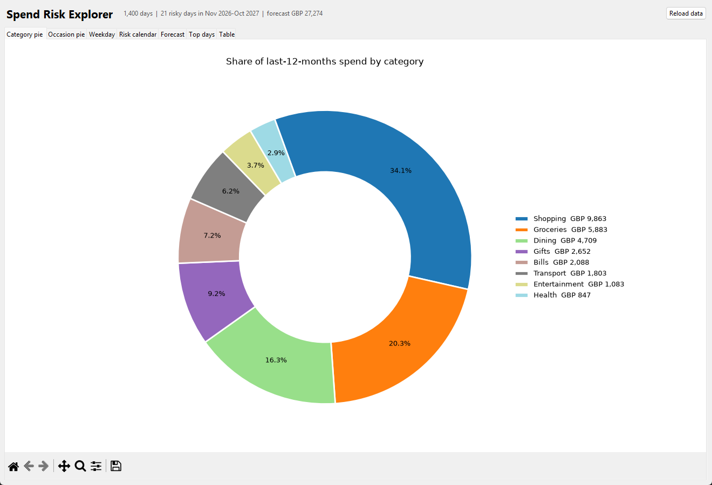
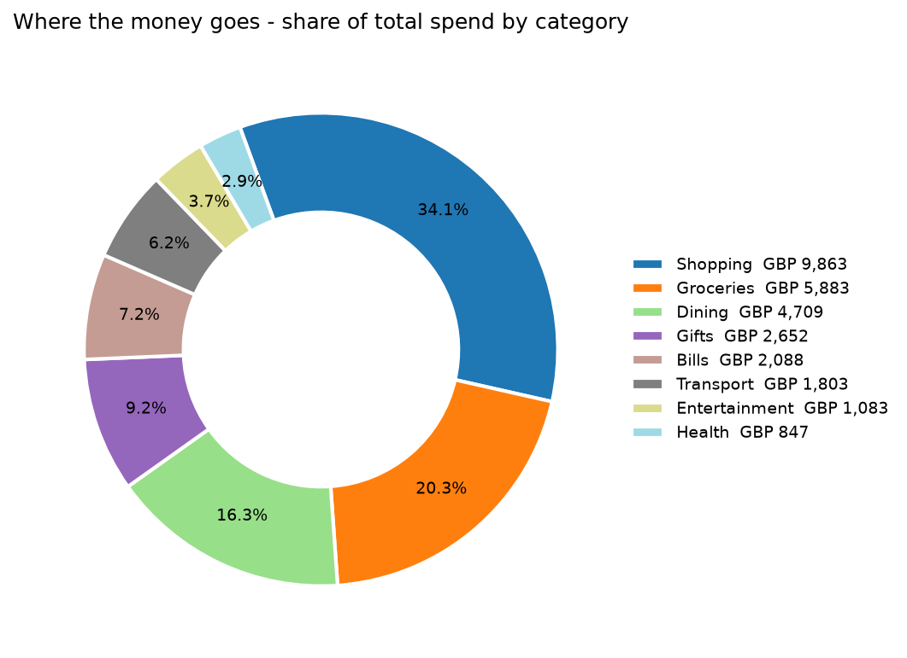
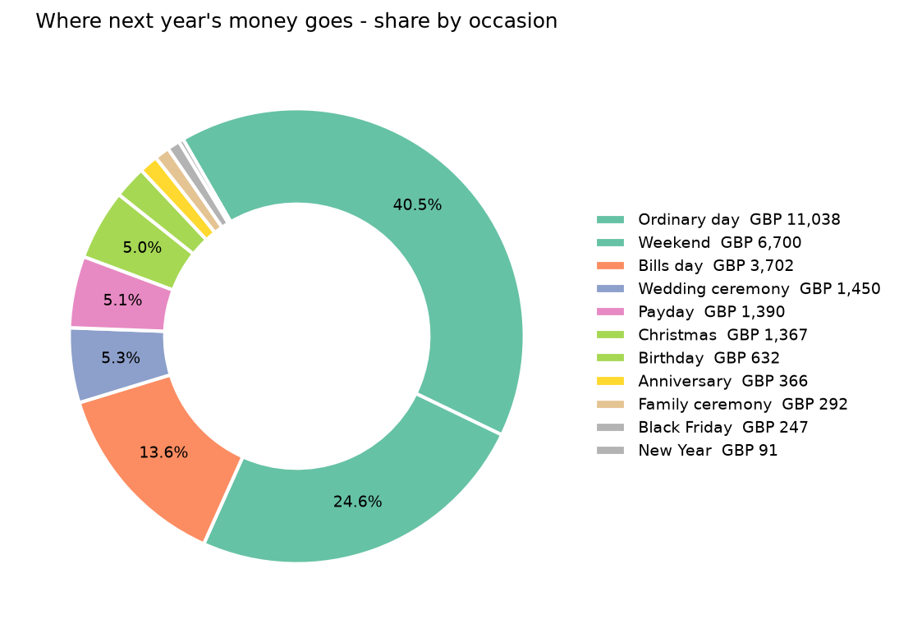
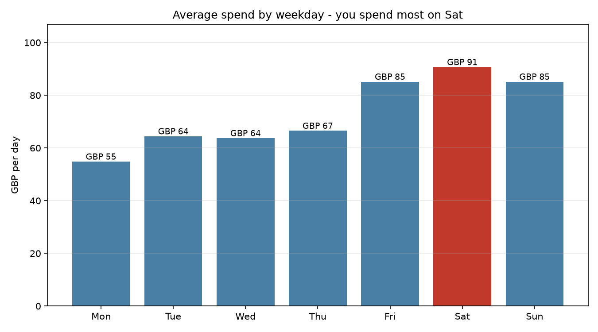
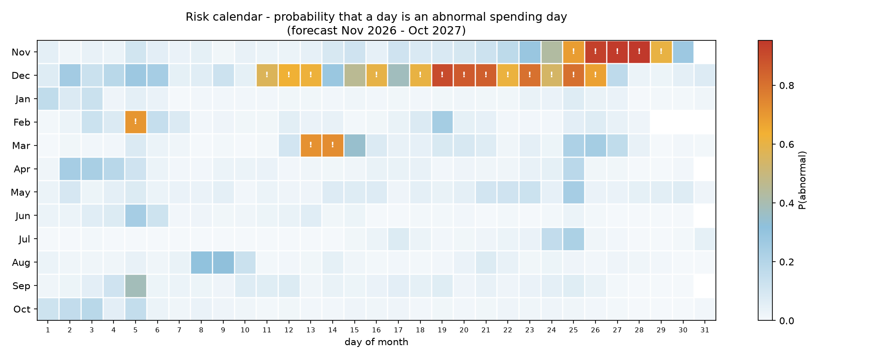
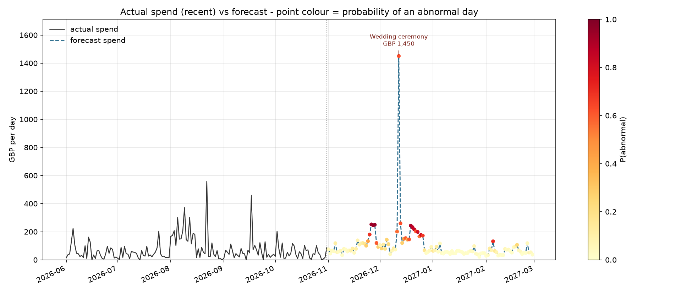
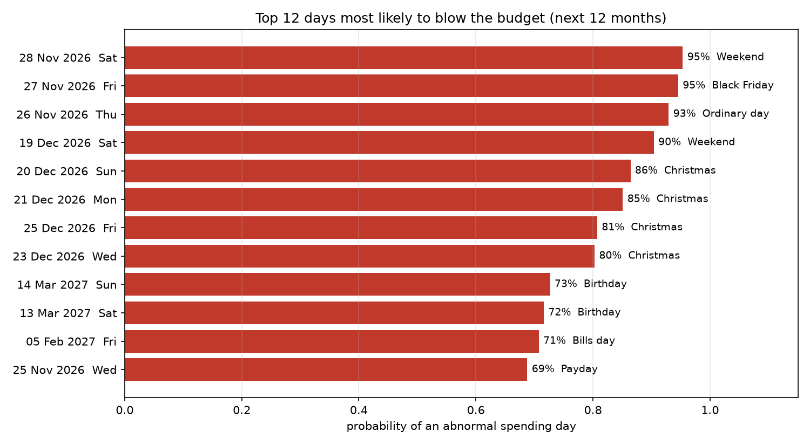

# Which days will I blow the budget?

A tiny, fully reproducible pipeline that:

1. generates a **fake** (synthetic) personal transaction log in CSV,
2. learns what an **"abnormal spending day"** looks like from the calendar,
3. **forecasts the next 12 months** and ranks the days you are most likely to spend far more than usual (birthday, Christmas, family ceremony, Black Friday, payday, bills day, weekends),
4. renders pie charts plus a risk calendar / timeline.

Everything runs on the fabricated data in `data/` — no personal or downloaded data is used.

---

## Quick start

```powershell
cd L:\save\userdata\Downloads\guk
pip install -r requirements.txt
python src/generate_data.py     # writes data/*.csv  (seeded, deterministic)
python src/model.py             # trains + writes reports/*
python GUI.py                   # optional desktop app with all charts
# or simply:
.\run.ps1
```

Python 3.10+; needs `pandas`, `numpy`, `scikit-learn`, `matplotlib` (Tkinter ships with Python).

---

## GUI

`GUI.py` puts every chart in one Tkinter window — matplotlib canvases, live zoom/pan
toolbar and a sortable table of the riskiest days. It reads the CSVs, so run the
pipeline once first.

```powershell
python GUI.py            # open the app
python GUI.py --smoke    # render every chart to PNG without opening a window
```

Tabs: **Category pie · Occasion pie · Weekday · Risk calendar · Forecast · Top days · Table**
(plus a *Reload data* button to refresh after re-running the model).



---

## The answers on this dataset

| Question | Result |
|---|---|
| Day of the week with the highest average spend | **Saturday — £91/day** (vs £55 on Monday) |
| Definition of "abnormal" | daily total above the **90th percentile of 2023–2025** = **£166.01** |
| Test-year hit rate (top 10 ranked days) | **60%** were genuinely abnormal (baseline 10%) |
| Next 12 months (Nov 2026 – Oct 2027) | forecast **£27,274** total, **21 days** flagged ≥50% risk |

Most likely blow-the-budget days in the forecast year:

| Date | Weekday | P(abnormal) | Expected spend | Why |
|---|---|---|---|---|
| 2026-11-28 | Sat | 95% | £250 | weekend + Black Friday weekend |
| 2026-11-27 | Fri | 95% | £247 | Black Friday |
| 2026-11-26 | Thu | 93% | £252 | pre-Black-Friday spending |
| 2026-12-19 | Sat | 90% | £244 | pre-Christmas Saturday |
| 2026-12-20 | Sun | 86% | £232 | Christmas week |
| 2026-12-21 | Mon | 85% | £217 | Christmas week |
| 2026-12-25 | Fri | 81% | £177 | Christmas Day |
| 2027-03-14 | Sun | 73% | £162 | birthday |
| 2027-02-05 | Fri | 71% | £132 | bills day |

The single biggest day of the year is the planned **wedding ceremony on 2026-12-12 (≈£1,450)**, which the model cannot invent from history — its budget is read from `data/events.csv` and added on top of the calendar prediction.

---

## Charts (`reports/`)

| File | What it shows |
|---|---|
| `pie_by_category.png` | share of total spend per category |
| `pie_by_occasion.png` | share of next year's spend per occasion |
| `weekday_spend.png` | average spend per weekday, peak day highlighted |
| `risk_calendar.png` | month × day heatmap of P(abnormal day) for the next 12 months |
| `forecast_timeline.png` | recent actuals + forecast, points coloured by risk |
| `top_upcoming_days.png` | the 12 riskiest days, with reasons |








---

## Files

```
guk/
├─ data/
│  ├─ transactions_fake.csv   one row per transaction (5,153 rows)
│  ├─ daily_spend.csv         daily totals + per-category columns (1,400 days)
│  └─ events.csv              event calendar incl. future + planned budgets
├─ src/
│  ├─ generate_data.py        synthetic data generator (seed = 42)
│  └─ model.py                features, training, evaluation, forecast, charts
├─ GUI.py                     desktop app with all charts in tabs
├─ reports/
│  ├─ forecast_next_12_months.csv   day-by-day p(abnormal) + expected spend
│  ├─ weekday_profile.csv
│  ├─ metrics.json
│  └─ *.png
├─ run.ps1
└─ requirements.txt
```

### Data schema

`transactions_fake.csv`

| column | example |
|---|---|
| date | 2026-06-21 |
| time | 19:42 |
| category | Dining, Groceries, Shopping, Gifts, Bills, Transport, Health, Entertainment |
| merchant | Nando's |
| amount | 38.40 |
| note | Birthday dinner (empty for ordinary transactions) |
| payment_method | contactless |

Range: 2023-01-01 → 2026-10-31. Total £102,106; mean £72.93/day.
Rent/mortgage is deliberately excluded — this is discretionary card spending.

`events.csv`

| column | meaning |
|---|---|
| date, end_date | event window (equal for single-day events) |
| event | Birthday, Christmas, Family ceremony, Anniversary, Black Friday, New Year, Holiday trip, Wedding ceremony |
| recurrence | annual / one-off |
| planned_amount | budget for one-off events (0 otherwise) |

The generator is seeded, so the CSVs are byte-stable across runs.

---

## How the model works

**Target.** `abnormal = 1` if the day's total exceeds the 90th percentile of the training period (£166.01). About 10% of days qualify.

**Features — all known in advance, so no leakage into the future:**
weekday, month, day-of-month, weekend flag, signed distance in days to birthday / family ceremony / anniversary / Christmas / Black Friday, days to payday and month end, inside-an-event-window flag, and (classifier only) the planned budget of a known event.

**Two tiny gradient-boosted trees** (`HistGradientBoosting`, depth 3, ≤300 iterations):

* classifier → probability that the day is abnormal,
* regressor → expected spend for the day (planned event budget added afterwards, because a tree cannot extrapolate to an unseen ceremony cost).

**Validation.** Train 2023-01-01 → 2025-12-31, test 2026-01-01 → 2026-10-31 (304 days, 25 abnormal days, 8.2% base rate):

| metric | model | naive weekday×month baseline |
|---|---|---|
| ROC AUC | **0.750** | — |
| average precision | **0.375** | 0.082 (base rate) |
| precision @ top 10 | **0.60** | 0.10 |
| precision @ top 25 | **0.36** | 0.12 |
| spend MAE | £41.33 | — |
| spend median abs. error | £25.95 | — |

Top drivers by permutation importance: `in_event_window`, day-of-month, distance to anniversary, distance to ceremony, weekday, distance to payday.

---

## Limitations

* **The data is fake.** The patterns are ones I deliberately generated; the numbers say nothing about you or about real consumers. Swap in a real export and the same code runs unchanged.
* One year of daily data is noisy; treat the probabilities as a ranking, not calibrated odds.
* No transaction-level text, no income, no recurring-vs-discretionary split.
* Rent and large standing transfers are excluded, so "abnormal" means *discretionary* spikes.

### Using your own data

Keep the same two files and rerun `python src/model.py`:

* `data/daily_spend.csv` — needs at least `date,total` (one row per day, zeros included).
* `data/events.csv` — `date,end_date,event,recurrence,planned_amount`. Add future events (birthday, trips, weddings) for the forecast to see them.
